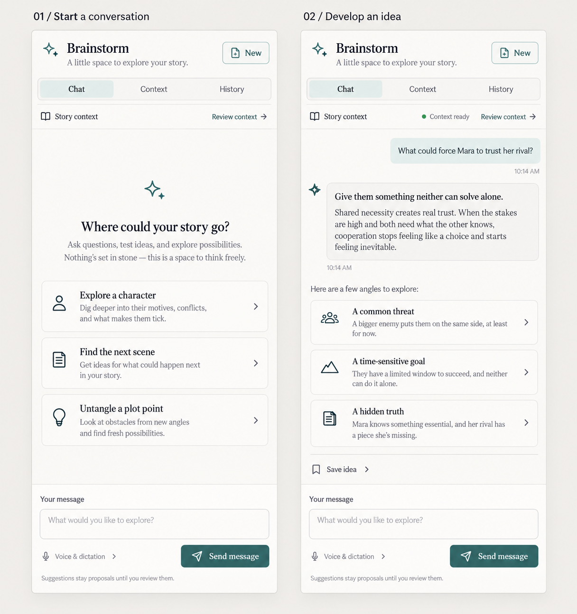
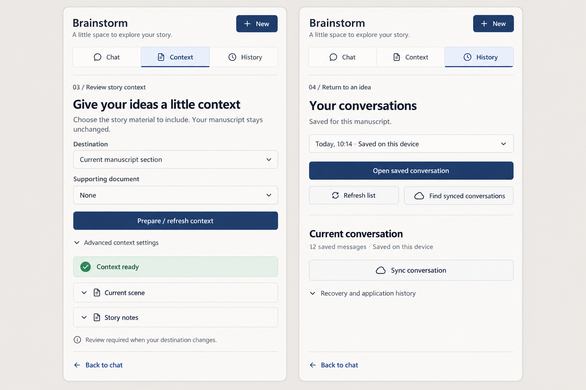

# Brainstorm sidebar references

Generated with the built-in ImageGen tool on 2026-10-08. These are design references, not application screenshots. Implementation uses Prosa's existing navy theme tokens. Generated conversation content is illustrative; the product renders real saved turns.

## Chat reference



```text
Use case: ui-mockup. Create a high-fidelity reference image for Prosa writing app's Brainstorm right sidebar redesign. Show TWO narrow sidebar states side by side on a light warm gray presentation canvas, each 400px wide and about 850px tall, front-facing flat UI, beautifully readable crisp typography. Label above them '01 / Start a conversation' and '02 / Develop an idea'. Calm warm-white panels, fine neutral borders, charcoal text, muted stone secondary text, muted teal accent buttons, no gradients, no extravagant graphics. Each sidebar top: small teal sparkle icon beside 'Brainstorm', subtitle 'A little space to explore your story.', compact 'New' button. Below a three-item segmented navigation 'Chat' (selected), 'Context', 'History'. Below compact context row 'Story context' left, 'Review context' right. First panel: spacious empty chat with small outlined sparkle, headline 'Where could your story go?', two lines supporting copy, three vertically stacked clickable prompt cards 'Explore a character', 'Find the next scene', 'Untangle a plot point'. Bottom anchored full-width composer with label 'Your message', placeholder 'What would you like to explore?', small 'Voice & dictation' disclosure, teal Send message button at right, muted note 'Suggestions stay proposals until you review them.' Second panel same header/tabs with green dot 'Context ready'; conversation with right aligned pale teal user message 'What could force Mara to trust her rival?' and left assistant message 'Give them something neither can solve alone.' and three short suggestions, one compact 'Save idea' disclosure. Same bottom composer. Use realistic implementable accessible desktop UI proportions with generous negative space, elegant typography, NO technical IDs, raw enums, token counters, giant fieldsets or nested overwhelming forms.
```

## Context and history reference



```text
Use case: ui-mockup. High fidelity flat front-facing production Prosa writer app sidebar reference, TWO 400px wide sidebars side by side on warm-gray canvas. Match a calm warm-white writing UI with fine stone borders, charcoal Segoe UI typography, deep navy #1f355f accent, 12px corners, generous space. Heading Brainstorm, subtitle 'A little space to explore your story.', New button top right; segmented Chat / Context / History. Left labelled '03 / Review story context', Context selected. Title 'Give your ideas a little context', text 'Choose the story material to include. Your manuscript stays unchanged.' Structured labeled Destination dropdown 'Current manuscript section', Supporting document dropdown 'None', navy 'Prepare / refresh context' button, small collapsed 'Advanced context settings'. Below greenish quiet status 'Context ready', two collapsed sources 'Current scene' and 'Story notes'. Small footnote 'Review required when your destination changes.' Right labelled '04 / Return to an idea', History selected. Title 'Your conversations', helper 'Saved for this manuscript', dropdown with friendly 'Today, 10:14 · Saved on this device', 'Open saved conversation' button, secondary 'Refresh list' and 'Find synced conversations' buttons. Divider, title 'Current conversation', small '12 saved messages · Saved on this device', 'Sync conversation' button, collapsed 'Recovery and application history'. Both bottom return link 'Back to chat'. No ID strings, raw enums or token counts. Exact readable typography. No invented manuscript edits, no extra panes or marketing graphics.
```

